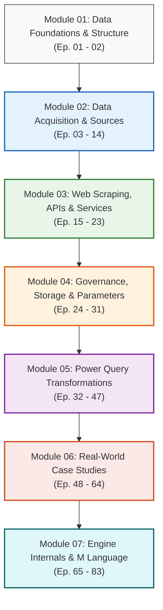

# 🎓 Complete Course Curriculum & Learning Roadmap

> **Course:** Microsoft Power BI Data Analysis Diploma (دبلومة تحليل البيانات)  
> **Instructor:** Eng. Essam Elsayed (المهندس عصام الصياد) - Microsoft Certified Trainer (MCT)  
> **Official Playlist:** [YouTube Playlist Link](https://www.youtube.com/playlist?list=PLkYJ59mAhUsMbZQ4AmBmGt0EEyrTrg5mX)  

---

## 🧭 Course Vision & Architecture
This diploma is designed to take aspiring and practicing data professionals from data ingestion fundamentals to enterprise-grade business intelligence engineering. It centers heavily on **Microsoft Power BI**, the **Power Query ETL Mashup Engine**, and deep mastery of the functional **M Language**.

---

## 📚 Detailed Syllabus Breakdown

### [Module 01: Data Foundations & Raw Data Principles](01-Data-Foundations/README.md) (Ep. 01 - 02)
- **Ep 01:** Introduction to the Data Analysis Diploma, BI Architecture, and Tooling Setup.
- **Ep 02:** Proper Raw Data Structure (Tidy Data principles, variable columns vs observation rows).

### [Module 02: Data Acquisition - Files, Cloud & Enterprise Databases](02-Data-Acquisition/README.md) (Ep. 03 - 14)
- **Ep 03:** Connecting to Microsoft Excel (Worksheets, Tables, Defined Names).
- **Ep 04 & 05:** Ingesting CSV/TXT files & Troubleshooting Delimiters, Encodings, and Quote Styles.
- **Ep 06:** Ingesting Tabular Data from PDF Documents.
- **Ep 07:** On-Premises Data Gateway Architecture & Scheduled Cloud Refreshes.
- **Ep 08 & 09:** Cloud Files Ingestion: Microsoft OneDrive & SharePoint Document Libraries.
- **Ep 10 & 11:** Google Workspace Ingestion: Google Sheets & Google Drive Direct Connections.
- **Ep 12:** Relational Databases: SQL Server, Oracle & SAP HANA with Query Folding.
- **Ep 13:** Connecting to Published Enterprise Power BI Semantic Models (Single Source of Truth).
- **Ep 14:** Connecting to Microsoft Exchange / Outlook Mailboxes & Attachment Harvesting.

### [Module 03: Advanced Data Extraction - Web Scraping, REST APIs & Social Analytics](03-Advanced-Data-Extraction/README.md) (Ep. 15 - 23)
- **Ep 15, 16 & 17:** Web Scraping Mastery (HTML tables, Parameterized Functions, and Dynamic Pagination).
- **Ep 18 & 19:** REST API Integration & Stateful Loop Pagination with `List.Generate`.
- **Ep 20 & 21:** Ingesting Professional & Social Feeds (LinkedIn & X/Twitter).
- **Ep 22:** Querying Microsoft Dataverse Entities & Common Data Model.
- **Ep 23:** Normalizing Deeply Nested JSON Objects (Facebook & Instagram Exports).

### [Module 04: Governance, Storage Modes & Parameterized Automation](04-Governance-and-Automation/README.md) (Ep. 24 - 31)
- **Ep 24:** Data Privacy Levels (Public, Org, Private) & Eliminating `Formula.Firewall` Errors.
- **Ep 25:** Creating PBIDS Files for Enterprise Data Source Distribution.
- **Ep 26:** Endorsement & Discoverability Governance (Certified vs Promoted).
- **Ep 27:** Power Platform Dataflows for Reusable Cloud-Based ETL.
- **Ep 28 & 29:** Storage Modes (Import, DirectQuery, Live Connection, Dual/Composite Models).
- **Ep 30 & 31:** Dynamic Parameters & Distributing Lightweight Power BI Templates (`.pbit`).

### [Module 05: Data Transformation & Cleaning Techniques](05-Data-Transformation/README.md) (Ep. 32 - 47)
- **Ep 32 & 33:** Power Query Data Type Internals, VertiPaq Compression, and Conversions.
- **Ep 34:** Local Interpretation ('Using Locale...') for International Dates and Currencies.
- **Ep 35, 36 & 37:** Creating Custom Columns, Conditional Columns, and Columns From Examples.
- **Ep 38 & 39:** Splitting/Merging Fields & Invoking Custom Row Functions.
- **Ep 40 & 41:** The Core of Reshaping: Pivoting and Unpivoting (`Table.UnpivotOtherColumns`).
- **Ep 42:** Resolving Multi-Tier Double Headers via Transposition and Fill-Down.
- **Ep 43 & 44:** Appending Queries (Vertical Stacking & Schema Drift Reconciliation).
- **Ep 45, 46 & 47:** Merge Queries (Inner, Left Outer, Full Outer, Anti Joins) & Fuzzy Matching.

### [Module 06: Real-World Case Studies & Enterprise Projects](06-Case-Studies/README.md) (Ep. 48 - 64)
- **Ep 48:** Horizontal Date Matrix Normalization.
- **Ep 49:** Restructuring Corrupt Fragmented Transaction Rows.
- **Ep 50:** International Economic Macroeconomic GDP Database Cleaning.
- **Ep 51:** Fragmented, Duplicate & Multi-Table Merge Case Study.
- **Ep 52:** Monthly Sales Modeling: Bridging Daily Actuals with Monthly Budgets.
- **Ep 53:** Group By Aggregation for Sales Forecast Reconciliation.
- **Ep 54:** Complex 4-Tier Nested Header Restructuring.
- **Ep 55:** Capstone Project 1: Multi-Source Sales BI Pipeline.
- **Ep 56:** Capstone Project 2: Multi-Source Data Integration & Star Schema Modeling.
- **Ep 57:** Robust Inconsistent Folder Ingestion (Filtering Garbage & Lock Files).
- **Ep 58:** Replacing Hardcoded Logic with Dynamic Expressions.
- **Ep 59:** Understanding Evaluation Context vs Analytical Logic.
- **Ep 60:** Resolving Contradictory Regional Locales in Mixed Datasets.
- **Ep 61:** Converting Vertical Metric Pairs into Structured Relational Records.
- **Ep 62 & 63:** Practical Exercises 1 & 2 (Hands-on Capstones).
- **Ep 64:** Multi-Bank PDF Financial Statement Consolidation (Alrajhi & SNB).

### [Module 07: Power Query Engine Internals & Advanced M Language](07-Power-Query-Engine-and-M-Language/README.md) (Ep. 65 - 83)
- **Ep 65:** Engine Deep-Dive: Null vs Blank vs DAX `BLANK()`.
- **Ep 66:** Cartesian Products (Cross Joins): Generating Combinations & Avoiding Crashes.
- **Ep 67:** Safe vs Breaking Changes & Preserving Query Folding.
- **Ep 68:** Step Errors vs Cell Errors (Auditing and Fault Tolerance).
- **Ep 69 & 70:** Functional Programming in M: Let-In Scoping, Lists, Records, Tables & Lambdas.
- **Ep 71:** Practical Exercise 3: Direct M-Code Challenge.
- **Ep 72:** Enterprise Architecture: Decoupling Pipelines with Helper & Staging Queries.
- **Ep 73:** Building Modular, Typed Reusable M Custom Functions.
- **Ep 74:** Sequence & Frequency Analysis: Offset Indexing & Inter-Event Durations.
- **Ep 75:** Resilient Ingestion of Dynamic Payloads with `MissingField` Enumeration.
- **Ep 76:** Financial Rounding Compliance: Banker's Rounding vs Commercial AwayFromZero.
- **Ep 77:** The Philosophy & Logic of Thinking in Declarative Data Transformations.
- **Ep 78:** Dynamic Multi-Worksheet Ingestion & Schema Consolidation.
- **Ep 79:** Bulk Column Processing with `Table.TransformColumns`.
- **Ep 80:** The Null Coalescing Operator (`??`) for Concise Fallbacks.
- **Ep 81:** Exception Handling in Production with `try ... otherwise`.
- **Ep 82:** Reference Outside Scope: Scoping Rules, Closures & Lexical Environments in M Language.
- **Ep 83:** Complex Date Transformations: Date Calculations, Durations, Quarters & Custom Time Periods.

---
*Created as part of the Microsoft Power BI Data Analysis Diploma Repository.*
