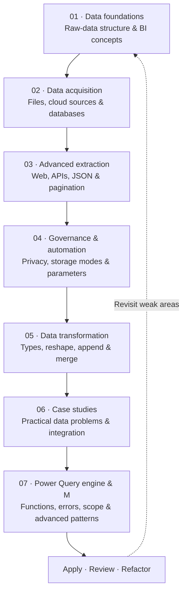
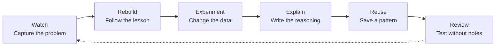

<div align="center">

# Microsoft Power BI Data Analysis Diploma

### A structured, hands-on learning companion for Power BI, Power Query, and M

[](https://www.youtube.com/@EssamMCT)
[](CURRICULUM.md)
[](https://powerbi.microsoft.com/desktop/)
[](M_LANGUAGE_CHEATSHEET.md)

**A practical documentation hub** for the 83-episode Microsoft Power BI Data Analysis Diploma taught by Eng. Essam Elsayed (MCT).

[Course playlist](https://www.youtube.com/playlist?list=PLkYJ59mAhUsMbZQ4AmBmGt0EEyrTrg5mX) · [Curriculum](CURRICULUM.md) · [Learning path](docs/LEARNING_PATH.md) · [M cheatsheet](M_LANGUAGE_CHEATSHEET.md)

</div>

---

## Start here

This repository is designed to help learners move from watching lessons to building repeatable data-preparation workflows. It brings together the course map, lecture notes, practice assets, reusable M patterns, and a personal progress tracker.

| I want to… | Open |
|---|---|
| Understand the full diploma structure | [Course curriculum](CURRICULUM.md) |
| Follow a recommended study routine | [Learning path & study method](docs/LEARNING_PATH.md) |
| Find a lecture, its notes, or practice folder | [Episode tracker](PROGRESS_TRACKER.md) |
| Look up M syntax and reusable expressions | [Power Query M cheatsheet](M_LANGUAGE_CHEATSHEET.md) |
| Practice the concepts independently | [Practice challenges](docs/PRACTICE_CHALLENGES.md) |
| Follow consistent lecture notes | [Documentation standard](docs/DOCUMENTATION_STANDARD.md) · [Episode template](templates/EPISODE_README_TEMPLATE.md) |
| Work through a repeatable data-cleaning process | [Power Query workflow playbook](docs/POWER_QUERY_WORKFLOW.md) |
| Understand the diagrams and end-to-end flow | [Learning diagrams](docs/DIAGRAMS.md) |
| Contribute notes or improve documentation | [Contribution guide](CONTRIBUTING.md) |

## The learning journey

The curriculum is organized into seven connected phases. Each phase builds on the previous one, from understanding source data to writing reusable M transformations and handling less predictable data.



| Phase | Episodes | Focus |
|---|:---:|---|
| [01 · Data Foundations](01-Data-Foundations/README.md) | 01–02 | BI context, tidy data, and raw-data structure |
| [02 · Data Acquisition](02-Data-Acquisition/README.md) | 03–14 | Excel, CSV, PDF, cloud services, and databases |
| [03 · Advanced Data Extraction](03-Advanced-Data-Extraction/README.md) | 15–23 | Web extraction, REST APIs, pagination, and JSON |
| [04 · Governance & Automation](04-Governance-and-Automation/README.md) | 24–31 | Privacy, credentials, dataflows, storage modes, and parameters |
| [05 · Data Transformation](05-Data-Transformation/README.md) | 32–47 | Data types, columns, pivoting, appending, and joins |
| [06 · Case Studies](06-Case-Studies/README.md) | 48–64 | Real-world cleaning, integration, and analytical scenarios |
| [07 · Engine & M Language](07-Power-Query-Engine-and-M-Language/README.md) | 65–83 | M fundamentals, custom functions, errors, and dynamic transformations |

> **Episode count:** The documented curriculum contains **83 episodes** (01–83). Some lecture folders intentionally group multiple related episodes. Use the curriculum and tracker as the episode-level source of truth.

## A practical learning loop

Watching a lesson is only the input. Use this cycle to turn each topic into a skill you can explain, reproduce, and reuse.



For a detailed routine, checkpoints, and suggested evidence to capture, see the [Learning Path](docs/LEARNING_PATH.md).

## What lives in this repository?

- **Lecture resources:** organized by curriculum phase and episode, with lesson notes and practice material where available.
- **Curriculum and tracker:** a complete episode map plus a checklist for recording completion, dates, and takeaways.
- **M language reference:** examples for tables, lists, records, joins, functions, error handling, and dynamic transformations.
- **Workflow guidance:** a practical checklist for profiling, transforming, validating, and documenting data.
- **Playlist synchronization:** GitHub Actions and local scripts intended to detect new playlist episodes and refresh repository documentation.

### Repository map

```text
.
├── 01-Data-Foundations/
├── 02-Data-Acquisition/
├── 03-Advanced-Data-Extraction/
├── 04-Governance-and-Automation/
├── 05-Data-Transformation/
├── 06-Case-Studies/
├── 07-Power-Query-Engine-and-M-Language/
├── docs/
│   ├── DIAGRAMS.md
│   ├── LEARNING_PATH.md
│   └── POWER_QUERY_WORKFLOW.md
├── metadata/
├── scripts/
├── .github/workflows/
├── CONTRIBUTING.md
├── CURRICULUM.md
├── M_LANGUAGE_CHEATSHEET.md
├── PROGRESS_TRACKER.md
└── README.md
```

The folders above describe the intended organization; individual episode folders may contain different combinations of notes and source/practice files.

## Recommended setup

1. Install [Power BI Desktop](https://powerbi.microsoft.com/desktop/).
2. Use Excel or another supported source application when a lesson requires it.
3. Install [Git](https://git-scm.com/) and [Git LFS](https://git-lfs.com/) before cloning if you need the tracked binary practice assets.

```bash
git lfs install
git clone https://github.com/Sohila-Khaled-Abbas/powerbi-data-analysis-diploma.git
cd powerbi-data-analysis-diploma
git lfs pull
```

If you only need the notes and Markdown references, browsing the repository on GitHub is enough; you do not need to clone it.

## Playlist synchronization

The repository includes a GitHub Actions workflow at [`.github/workflows/sync_playlist.yml`](.github/workflows/sync_playlist.yml) and local scripts under [`scripts/`](scripts/).

- The workflow is scheduled for 06:00 and 18:00 UTC and can also be started manually from the Actions tab.
- The sync script is intended to check the course playlist and update episode documentation and metadata.
- Review generated changes before relying on newly added episode notes or downloaded practice assets.

The workflow requires the repository's configured permissions and any external credentials used by the scripts. See the workflow and script source for the actual implementation details.

## Instructor & source material

- **Instructor:** Eng. Essam Elsayed (المهندس عصام الصياد), Microsoft Certified Trainer (MCT)
- **YouTube channel:** [Essam MCT](https://www.youtube.com/@EssamMCT)
- **Official playlist:** [Microsoft Power BI Data Analysis Diploma](https://www.youtube.com/playlist?list=PLkYJ59mAhUsMbZQ4AmBmGt0EEyrTrg5mX)

This repository is an independent learning companion. Course ownership and original lecture content remain with their respective creator. Follow the source playlist for the instructor's explanations and use this repository for your own structured notes and practice.

---

<div align="center">

**Learn the concept · Rebuild the workflow · Explain the logic · Reuse the pattern**

If this repository supports your learning, consider starring it.

</div>
