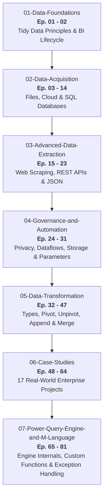

# 📊 Microsoft Power BI Data Analysis Diploma (دبلومة تحليل البيانات)

<p align="center">
  
  
  
  
  
</p>

> 🎯 **A comprehensive, production-grade GitHub learning repository and technical documentation hub for the complete 81-lecture Microsoft Power BI Data Analysis Diploma taught by Eng. Essam Elsayed (عصام الصياد) on YouTube.**

📺 **Official YouTube Playlist:** [Watch All 81 Lectures on YouTube](https://www.youtube.com/playlist?list=PLkYJ59mAhUsMbZQ4AmBmGt0EEyrTrg5mX)

---

## 🌟 About This Course & Repository
This repository serves as a structured, hands-on self-study companion for the **Microsoft Power BI Data Analysis Diploma**. It organizes all 81 video lectures into **7 modular phases**, providing:
- 📂 **Structured Practice Folders**: Cleanly arranged datasets (`.pbix`, `.xlsx`, `.csv`, `.pdf`, `.json`) corresponding directly to each lecture.
- 📖 **Deep Technical Documentation**: In-depth `README.md` for every single lecture explaining core business concepts, methodology, and step-by-step instructions.
- ⚡ **M Language Code Reference**: Practical, ready-to-use M expressions, custom function templates, and engine optimization patterns.
- 📊 **Interactive Progress Tracker**: A personal checklist ([`PROGRESS_TRACKER.md`](PROGRESS_TRACKER.md)) to track your study journey.
- 📑 **M Language Master Cheatsheet**: A rapid lookup guide ([`M_LANGUAGE_CHEATSHEET.md`](M_LANGUAGE_CHEATSHEET.md)) for Power Query syntax.

---

## 🧭 Curriculum Architecture & Learning Path



See the full [**Course Curriculum & Syllabus (CURRICULUM.md)**](CURRICULUM.md) for deep syllabus details.

---

## 📑 Master Episode Directory (All 81 Lectures)

| Ep # | Module | Lecture Title | Duration | Hands-On Folder | Video Link | Official Sample Data |
|:----:|:-------|:--------------|:--------:|:----------------|:----------:|:--------------------:|
| **01** | `Data Foundations` | دبلومة تحليل البيانات - المحاضرة (١) - مقدمة | `13m 16s` | [Ep01-Introduction](01-Data-Foundations/Ep01-Introduction/README.md) | [▶ YouTube](https://www.youtube.com/watch?v=Q9kLloQcqTA) | Included / Lecture |
| **02** | `Data Foundations` | Proper Raw Data Structure | `1h 18m 52s` | [Ep02-Proper-Raw-Data-Structure](01-Data-Foundations/Ep02-Proper-Raw-Data-Structure/README.md) | [▶ YouTube](https://www.youtube.com/watch?v=vLgu68SUKPU) | [Sample Data](https://drive.google.com/file/d/1Jk9Z4xOK1r_mKwtAcnmZ-dlK3zSpx0i8/view?usp=sharing) |
| **03** | `Data Acquisition` | Get Data From Microsoft Excel | `44m 33s` | [Ep03-Get-Data-From-Excel](02-Data-Acquisition/Ep03-Get-Data-From-Excel/README.md) | [▶ YouTube](https://www.youtube.com/watch?v=BO6xDtaNLpA) | [Sample Data](https://drive.google.com/drive/folders/1UWs2R2CIeGZlS4hl0n0V6jr8Hb0_Cplu?usp=sharing) |
| **04** | `Data Acquisition` | Get Data From CSV Files | `33m 35s` | [Ep04-05-Get-Data-From-CSV](02-Data-Acquisition/Ep04-05-Get-Data-From-CSV/README.md) | [▶ YouTube](https://www.youtube.com/watch?v=2I00ZCmG204) | [Sample Data](https://drive.google.com/drive/folders/1kd63LXUQ8qZ21yU54xNTX1_PwLT_MXAm?usp=sharing) |
| **05** | `Data Acquisition` | Fixing CSV Import Issues | `6m 46s` | [Ep04-05-Get-Data-From-CSV](02-Data-Acquisition/Ep04-05-Get-Data-From-CSV/README.md) | [▶ YouTube](https://www.youtube.com/watch?v=TbyiWFP9IYE) | Included / Lecture |
| **06** | `Data Acquisition` | Get Data From PDFs | `26m 50s` | [Ep06-Get-Data-From-PDF](02-Data-Acquisition/Ep06-Get-Data-From-PDF/README.md) | [▶ YouTube](https://www.youtube.com/watch?v=FoofsFoj6ik) | [Sample Data](https://drive.google.com/drive/folders/15XsLUpRll4QUF5hiQv-sI7Z33N43uzgq?usp=sharing) |
| **07** | `Data Acquisition` | On-Premises Data Gateway | `28m 14s` | [Ep07-On-Premises-Data-Gateway](02-Data-Acquisition/Ep07-On-Premises-Data-Gateway/README.md) | [▶ YouTube](https://www.youtube.com/watch?v=LJRxoAyxZG8) | [Sample Data](https://docs.google.com/spreadsheets/d/1lQh89lXIJ5OF3j44NyMkdw-vfJEGti3B/edit?usp=sharing&ouid=106512834842891247892&rtpof=true&sd=true) |
| **08** | `Data Acquisition` | Get Data From OneDrive | `14m 56s` | [Ep08-Get-Data-From-OneDrive](02-Data-Acquisition/Ep08-Get-Data-From-OneDrive/README.md) | [▶ YouTube](https://www.youtube.com/watch?v=esTfWYjDWBs) | [Sample Data](https://docs.google.com/spreadsheets/d/1lQh89lXIJ5OF3j44NyMkdw-vfJEGti3B/edit?usp=sharing&ouid=106512834842891247892&rtpof=true&sd=true) |
| **09** | `Data Acquisition` | Get Data From SharePoint | `49m 31s` | [Ep09-Get-Data-From-SharePoint](02-Data-Acquisition/Ep09-Get-Data-From-SharePoint/README.md) | [▶ YouTube](https://www.youtube.com/watch?v=JAe7n3Fo1uU) | [Sample Data](https://drive.google.com/drive/folders/1HHCYLuq97qB9OQ5FIN0hAPf_HaAfUX6l?usp=sharing) |
| **10** | `Data Acquisition` | Get Data From Google Sheets | `32m 6s` | [Ep10-Get-Data-From-Google-Sheets](02-Data-Acquisition/Ep10-Get-Data-From-Google-Sheets/README.md) | [▶ YouTube](https://www.youtube.com/watch?v=Jil1SSWVFeU) | [Sample Data](https://drive.google.com/drive/folders/1jJ0wn1nepvgLh1Tiq2V59TZbuzthQFGd?usp=sharing) |
| **11** | `Data Acquisition` | Get Data From Google Drive | `17m 6s` | [Ep11-Get-Data-From-Google-Drive](02-Data-Acquisition/Ep11-Get-Data-From-Google-Drive/README.md) | [▶ YouTube](https://www.youtube.com/watch?v=JYGhyETA9yc) | [Sample Data](https://docs.google.com/spreadsheets/d/1hWUanCD3IanMbBAW_mDcXPHKs5UjPrUm/edit?usp=sharing&ouid=106512834842891247892&rtpof=true&sd=true) |
| **12** | `Data Acquisition` | Get Data From Database (SQL / Oracle / SAP) | `46m 21s` | [Ep12-Get-Data-From-Database](02-Data-Acquisition/Ep12-Get-Data-From-Database/README.md) | [▶ YouTube](https://www.youtube.com/watch?v=VQsinzZ4ERY) | [Sample Data](https://drive.google.com/file/d/1AOYbAyLbbsSYuvJe3uCpiPCiU4fATSRS/view?usp=sharing) |
| **13** | `Data Acquisition` | Get Data From Semantic Models | `22m 54s` | [Ep13-Get-Data-From-Semantic-Models](02-Data-Acquisition/Ep13-Get-Data-From-Semantic-Models/README.md) | [▶ YouTube](https://www.youtube.com/watch?v=YwKp3e43NQk) | [Sample Data](https://docs.google.com/spreadsheets/d/1BCYItMvRNeEHZWhjSe1Csx7d1plcyCi1/edit?usp=sharing&ouid=106512834842891247892&rtpof=true&sd=true) |
| **14** | `Data Acquisition` | Get Data From Microsoft Exchange | `23m 18s` | [Ep14-Get-Data-From-Microsoft-Exchange](02-Data-Acquisition/Ep14-Get-Data-From-Microsoft-Exchange/README.md) | [▶ YouTube](https://www.youtube.com/watch?v=U9rl2ygQSRs) | [Sample Data](https://drive.google.com/drive/folders/1pVWf-i4SiGqHtpdgYTIuBsFXagPSboxa?usp=sharing) |
| **15** | `Advanced Data Extraction` | Get Data From Web | `34m 43s` | [Ep15-17-Get-Data-From-Web](03-Advanced-Data-Extraction/Ep15-17-Get-Data-From-Web/README.md) | [▶ YouTube](https://www.youtube.com/watch?v=97jpUL-FJIY) | Included / Lecture |
| **16** | `Advanced Data Extraction` | Get Data From Web (Invoke) | `22m 13s` | [Ep15-17-Get-Data-From-Web](03-Advanced-Data-Extraction/Ep15-17-Get-Data-From-Web/README.md) | [▶ YouTube](https://www.youtube.com/watch?v=QrIstR9ZyaA) | Included / Lecture |
| **17** | `Advanced Data Extraction` | Get Data From Web (List) | `30m 41s` | [Ep15-17-Get-Data-From-Web](03-Advanced-Data-Extraction/Ep15-17-Get-Data-From-Web/README.md) | [▶ YouTube](https://www.youtube.com/watch?v=NLzEOoYmh1s) | Included / Lecture |
| **18** | `Advanced Data Extraction` | Get Data From API | `23m 20s` | [Ep18-19-Get-Data-From-API](03-Advanced-Data-Extraction/Ep18-19-Get-Data-From-API/README.md) | [▶ YouTube](https://www.youtube.com/watch?v=VejauRwSb8A) | Included / Lecture |
| **19** | `Advanced Data Extraction` | Get Data From API (List. Generate) | `34m 40s` | [Ep18-19-Get-Data-From-API](03-Advanced-Data-Extraction/Ep18-19-Get-Data-From-API/README.md) | [▶ YouTube](https://www.youtube.com/watch?v=Jrr34uXL7sk) | [Sample Data](https://drive.google.com/file/d/1eKPGO9RTRI2_ES3W-SkqLlj_1aGBGD7B/view?usp=sharing) |
| **20** | `Advanced Data Extraction` | Get Data From LinkedIn | `17m 20s` | [Ep20-Get-Data-From-LinkedIn](03-Advanced-Data-Extraction/Ep20-Get-Data-From-LinkedIn/README.md) | [▶ YouTube](https://www.youtube.com/watch?v=7VdsxREKcwo) | Included / Lecture |
| **21** | `Advanced Data Extraction` | Get Data From X (Twitter) | `9m 32s` | [Ep21-Get-Data-From-X-Twitter](03-Advanced-Data-Extraction/Ep21-Get-Data-From-X-Twitter/README.md) | [▶ YouTube](https://www.youtube.com/watch?v=6vDArBejQe0) | Included / Lecture |
| **22** | `Advanced Data Extraction` | Get Data From Dataverse | `23m 12s` | [Ep22-Get-Data-From-Dataverse](03-Advanced-Data-Extraction/Ep22-Get-Data-From-Dataverse/README.md) | [▶ YouTube](https://www.youtube.com/watch?v=G8JY_KzS6Yk) | [Sample Data](https://docs.google.com/spreadsheets/d/1-ZMOR_BBAc2jVTxUy7AynkK8MGVtDC-g/edit?usp=sharing&ouid=106512834842891247892&rtpof=true&sd=true) |
| **23** | `Advanced Data Extraction` | Get Data From JSON - Facebook - Instagram | `25m 20s` | [Ep23-Get-Data-From-JSON](03-Advanced-Data-Extraction/Ep23-Get-Data-From-JSON/README.md) | [▶ YouTube](https://www.youtube.com/watch?v=pQ-ZAmkhXzM) | [Sample Data](https://drive.google.com/file/d/178IbhuDlsTxMJr9VPaYBlQM2VROSlGuw/view?usp=sharing) |
| **24** | `Governance and Automation` | Permissions (Credential - Encryption - Privacy) | `34m 36s` | [Ep24-Permissions-Credential-Encryption-Privacy](04-Governance-and-Automation/Ep24-Permissions-Credential-Encryption-Privacy/README.md) | [▶ YouTube](https://www.youtube.com/watch?v=AsRyyXMOohg) | [Sample Data](https://drive.google.com/drive/folders/1ZotequXkTfprPqUoU3U_qPwb-d2jixsa?usp=sharing) |
| **25** | `Governance and Automation` | PBIDS (Power BI Data Source File) | `21m 2s` | [Ep25-PBIDS-Data-Source-File](04-Governance-and-Automation/Ep25-PBIDS-Data-Source-File/README.md) | [▶ YouTube](https://www.youtube.com/watch?v=QG_omh_AMu8) | [Sample Data](https://drive.google.com/drive/folders/1MHSgZ5UkhB1iov0vcunu_lCxgdJFg1fV?usp=sharing) |
| **26** | `Governance and Automation` | Endorsement & Discovery | `18m 44s` | [Ep26-Endorsement-and-Discovery](04-Governance-and-Automation/Ep26-Endorsement-and-Discovery/README.md) | [▶ YouTube](https://www.youtube.com/watch?v=LAEFxT-C0zg) | Included / Lecture |
| **27** | `Governance and Automation` | Power Platform (Data Flows) | `30m 20s` | [Ep27-Power-Platform-Dataflows](04-Governance-and-Automation/Ep27-Power-Platform-Dataflows/README.md) | [▶ YouTube](https://www.youtube.com/watch?v=7JjoYsJgWUE) | [Sample Data](https://docs.google.com/spreadsheets/d/16Uw12kENYL8EpVsSrruz5FjdoqOdiWfG/edit?usp=sharing&ouid=106512834842891247892&rtpof=true&sd=true) |
| **28** | `Governance and Automation` | Data Source Connections (Import, Direct & Live) | `21m 30s` | [Ep28-29-Data-Source-Connections-Storage-Modes](04-Governance-and-Automation/Ep28-29-Data-Source-Connections-Storage-Modes/README.md) | [▶ YouTube](https://www.youtube.com/watch?v=bVJ7fH16a3M) | Included / Lecture |
| **29** | `Governance and Automation` | Dual Mode Connection | `12m 41s` | [Ep28-29-Data-Source-Connections-Storage-Modes](04-Governance-and-Automation/Ep28-29-Data-Source-Connections-Storage-Modes/README.md) | [▶ YouTube](https://www.youtube.com/watch?v=Ygw7a4RRQ-I) | Included / Lecture |
| **30** | `Governance and Automation` | Parameters | `14m 52s` | [Ep30-31-Parameters-and-Templates](04-Governance-and-Automation/Ep30-31-Parameters-and-Templates/README.md) | [▶ YouTube](https://www.youtube.com/watch?v=OyhTs6jhBcM) | [Sample Data](https://drive.google.com/drive/folders/1v0-vZc1s-knXknWIxtitUEUBnNPL2jXO?usp=sharing) |
| **31** | `Governance and Automation` | Templates & Parameters | `21m 18s` | [Ep30-31-Parameters-and-Templates](04-Governance-and-Automation/Ep30-31-Parameters-and-Templates/README.md) | [▶ YouTube](https://www.youtube.com/watch?v=xmFHUOsRBmI) | [Sample Data](https://docs.google.com/spreadsheets/d/1XiQ0E58f1yB_Ib6l8uJrZKp29m5gNRx8/edit?usp=sharing&ouid=106512834842891247892&rtpof=true&sd=true) |
| **32** | `Data Transformation` | Different Data Types (Theory) | `25m 59s` | [Ep32-33-Different-Data-Types](05-Data-Transformation/Ep32-33-Different-Data-Types/README.md) | [▶ YouTube](https://www.youtube.com/watch?v=KeuW9GhCIbY) | Included / Lecture |
| **33** | `Data Transformation` | Different Data Types | `45m 18s` | [Ep32-33-Different-Data-Types](05-Data-Transformation/Ep32-33-Different-Data-Types/README.md) | [▶ YouTube](https://www.youtube.com/watch?v=p8wStMCEIbc) | [Sample Data](https://drive.google.com/drive/folders/1mCgtHkBd8rtNE89wM-fRmZpJWZzDtCcD?usp=sharing) |
| **34** | `Data Transformation` | Local Interpretation | `17m 36s` | [Ep34-Local-Interpretation](05-Data-Transformation/Ep34-Local-Interpretation/README.md) | [▶ YouTube](https://www.youtube.com/watch?v=NR93ZmJplk0) | [Sample Data](https://drive.google.com/drive/folders/1kXySoG8OwEKlbwOU4dIOR0P5Crt2qPTH?usp=sharing) |
| **35** | `Data Transformation` | Custom Columns | `29m 15s` | [Ep35-Custom-Columns](05-Data-Transformation/Ep35-Custom-Columns/README.md) | [▶ YouTube](https://www.youtube.com/watch?v=wzDHUwIVT_I) | [Sample Data](https://docs.google.com/spreadsheets/d/1b7VSsw7VT5YYqML7oA_hgG1IbR1RZT7Z/edit?usp=sharing&ouid=106512834842891247892&rtpof=true&sd=true) |
| **36** | `Data Transformation` | Conditional Columns | `24m 7s` | [Ep36-Conditional-Columns](05-Data-Transformation/Ep36-Conditional-Columns/README.md) | [▶ YouTube](https://www.youtube.com/watch?v=s97vRdiyEdE) | Included / Lecture |
| **37** | `Data Transformation` | Columns from Examples | `16m 1s` | [Ep37-Columns-From-Examples](05-Data-Transformation/Ep37-Columns-From-Examples/README.md) | [▶ YouTube](https://www.youtube.com/watch?v=t6JwFr04Aj4) | Included / Lecture |
| **38** | `Data Transformation` | Split and Merge Columns | `33m 42s` | [Ep38-Split-and-Merge-Columns](05-Data-Transformation/Ep38-Split-and-Merge-Columns/README.md) | [▶ YouTube](https://www.youtube.com/watch?v=2OR9JHAcxEM) | Included / Lecture |
| **39** | `Data Transformation` | Invoke Custom Function | `26m 54s` | [Ep39-Invoke-Custom-Function](05-Data-Transformation/Ep39-Invoke-Custom-Function/README.md) | [▶ YouTube](https://www.youtube.com/watch?v=8uAhgo19hxQ) | Included / Lecture |
| **40** | `Data Transformation` | UnPivot Columns | `21m 54s` | [Ep40-41-Unpivot-and-Pivot-Columns](05-Data-Transformation/Ep40-41-Unpivot-and-Pivot-Columns/README.md) | [▶ YouTube](https://www.youtube.com/watch?v=Y2FpX7VS73g) | [Sample Data](https://docs.google.com/spreadsheets/d/19dxijDLYslNs31k91lsvSEsJW4CB6tB4/edit?usp=sharing&ouid=107970738919672012073&rtpof=true&sd=true) |
| **41** | `Data Transformation` | Pivot Columns | `10m 53s` | [Ep40-41-Unpivot-and-Pivot-Columns](05-Data-Transformation/Ep40-41-Unpivot-and-Pivot-Columns/README.md) | [▶ YouTube](https://www.youtube.com/watch?v=SsMiqmbTLFM) | Included / Lecture |
| **42** | `Data Transformation` | Double Headers Issue | `15m 7s` | [Ep42-Double-Headers-Issue](05-Data-Transformation/Ep42-Double-Headers-Issue/README.md) | [▶ YouTube](https://www.youtube.com/watch?v=218KtXG4GVY) | Included / Lecture |
| **43** | `Data Transformation` | Append (Theory) | `10m 26s` | [Ep43-44-Append-Queries](05-Data-Transformation/Ep43-44-Append-Queries/README.md) | [▶ YouTube](https://www.youtube.com/watch?v=TGqI6xxEO28) | Included / Lecture |
| **44** | `Data Transformation` | Append | `27m 45s` | [Ep43-44-Append-Queries](05-Data-Transformation/Ep43-44-Append-Queries/README.md) | [▶ YouTube](https://www.youtube.com/watch?v=kqTcg-j5bk4) | [Sample Data](https://docs.google.com/spreadsheets/d/1_hWdLDXrnIIEjyUfiFntNA9LQhuJPZyi/edit?usp=sharing&ouid=107970738919672012073&rtpof=true&sd=true) |
| **45** | `Data Transformation` | Merge & Join Kind (Theory) | `13m 10s` | [Ep45-47-Merge-and-Fuzzy-Match](05-Data-Transformation/Ep45-47-Merge-and-Fuzzy-Match/README.md) | [▶ YouTube](https://www.youtube.com/watch?v=CxBN3M5kSxw) | Included / Lecture |
| **46** | `Data Transformation` | Merge & Join Kind | `16m 13s` | [Ep45-47-Merge-and-Fuzzy-Match](05-Data-Transformation/Ep45-47-Merge-and-Fuzzy-Match/README.md) | [▶ YouTube](https://www.youtube.com/watch?v=IAZ-1trfu7c) | [Sample Data](https://docs.google.com/spreadsheets/d/1wdzuZge2xv5o-UmSfOzDPpmUGQGV4n1Q/edit?usp=sharing&ouid=107970738919672012073&rtpof=true&sd=true) |
| **47** | `Data Transformation` | Fuzzy Match | `22m 41s` | [Ep45-47-Merge-and-Fuzzy-Match](05-Data-Transformation/Ep45-47-Merge-and-Fuzzy-Match/README.md) | [▶ YouTube](https://www.youtube.com/watch?v=G1hiA-uXyDg) | Included / Lecture |
| **48** | `Case Studies` | Horizontal Date Matrix | `17m 56s` | [Ep48-Horizontal-Date-Matrix](06-Case-Studies/Ep48-Horizontal-Date-Matrix/README.md) | [▶ YouTube](https://www.youtube.com/watch?v=DFCk5VfYmf0) | [Sample Data](https://docs.google.com/spreadsheets/d/1pPrz3pW14yRopHyD3YdOvjExma3i2pBD/edit?usp=sharing&ouid=107970738919672012073&rtpof=true&sd=true) |
| **49** | `Case Studies` | Fragmented Rows | `12m 41s` | [Ep49-Fragmented-Rows](06-Case-Studies/Ep49-Fragmented-Rows/README.md) | [▶ YouTube](https://www.youtube.com/watch?v=j2lfBaQoe-w) | [Sample Data](https://docs.google.com/spreadsheets/d/11EH1eoy1tlAoqxJ1JARN40OW9xWtJiwA/edit?usp=sharing&ouid=114716248435075749833&rtpof=true&sd=true) |
| **50** | `Case Studies` | GDP Database | `11m 5s` | [Ep50-GDP-Database](06-Case-Studies/Ep50-GDP-Database/README.md) | [▶ YouTube](https://www.youtube.com/watch?v=eb4cz-Z6BMA) | [Sample Data](https://drive.google.com/file/d/1pSWxQ0x_6w5z_N0iibXn99ND3dfrUXrZ/view?usp=sharing) |
| **51** | `Case Studies` | Fragmented, Duplicate & Merge | `9m 54s` | [Ep51-Fragmented-Duplicate-and-Merge](06-Case-Studies/Ep51-Fragmented-Duplicate-and-Merge/README.md) | [▶ YouTube](https://www.youtube.com/watch?v=FecDKZfggWg) | [Sample Data](https://docs.google.com/spreadsheets/d/15QhhgIBUsmb-57FZKiKgxDZgUk-hfim9/edit?usp=sharing&ouid=107970738919672012073&rtpof=true&sd=true) |
| **52** | `Case Studies` | Monthly Sales (Actual vs Budget) | `18m 55s` | [Ep52-Monthly-Sales-Actual-vs-Budget](06-Case-Studies/Ep52-Monthly-Sales-Actual-vs-Budget/README.md) | [▶ YouTube](https://www.youtube.com/watch?v=OEgMul_XKYE) | [Sample Data](https://docs.google.com/spreadsheets/d/1J-teTbS6_LaW1sSmQp16R_eqr7kzJ4Vy/edit?usp=sharing&ouid=107970738919672012073&rtpof=true&sd=true) |
| **53** | `Case Studies` | Group By (Actual vs Forecast) | `22m 30s` | [Ep53-Group-By-Actual-vs-Forecast](06-Case-Studies/Ep53-Group-By-Actual-vs-Forecast/README.md) | [▶ YouTube](https://www.youtube.com/watch?v=dUu93A6t5gM) | [Sample Data](https://docs.google.com/spreadsheets/d/1MuJ9EZnB-zKUMS8No5qQ_oJzcSFFg-tK/edit?usp=sharing&ouid=107970738919672012073&rtpof=true&sd=true) |
| **54** | `Case Studies` | Complex Header Structure | `18m 47s` | [Ep54-Complex-Header-Structure](06-Case-Studies/Ep54-Complex-Header-Structure/README.md) | [▶ YouTube](https://www.youtube.com/watch?v=Xb9kqBNln7A) | [Sample Data](https://docs.google.com/spreadsheets/d/17ta44Ce2F_jyEYoZlT1kOqm2fuG0ERee/edit?usp=sharing&ouid=107970738919672012073&rtpof=true&sd=true) |
| **55** | `Case Studies` | Full Project from Multiple Data Sources | `54m 33s` | [Ep55-Full-Project-Multiple-Sources](06-Case-Studies/Ep55-Full-Project-Multiple-Sources/README.md) | [▶ YouTube](https://www.youtube.com/watch?v=AcT5yK_oLMc) | [Sample Data](https://drive.google.com/drive/folders/1EO16UVQNId0DdowPc_8HTCl7FvEvae49?usp=sharing) |
| **56** | `Case Studies` | Multi-Source Data Integration & Modeling | `50m 28s` | [Ep56-Multi-Source-Integration-and-Modeling](06-Case-Studies/Ep56-Multi-Source-Integration-and-Modeling/README.md) | [▶ YouTube](https://www.youtube.com/watch?v=84iOcwPOvM0) | [Sample Data](https://drive.google.com/drive/folders/1rwi8bxdT5l_TBkomCyZAy9uM-OxR8Nq5) |
| **57** | `Case Studies` | Inconsistent Data Sources | `37m 56s` | [Ep57-Inconsistent-Data-Sources](06-Case-Studies/Ep57-Inconsistent-Data-Sources/README.md) | [▶ YouTube](https://www.youtube.com/watch?v=j_PFG3lIaaM) | [Sample Data](https://drive.google.com/drive/folders/1fLH6GoSZyYeUnM7IBxTc2IG-8afFezJY) |
| **58** | `Case Studies` | Hardcode vs Logic | `16m 57s` | [Ep58-Hardcode-vs-Logic](06-Case-Studies/Ep58-Hardcode-vs-Logic/README.md) | [▶ YouTube](https://www.youtube.com/watch?v=xus1508g4Pw) | [Sample Data](https://docs.google.com/spreadsheets/d/1R3wJ3G4olGDGQI1k3vsrZN6xa0iTsmDq/edit?gid=39706116#gid=39706116) |
| **59** | `Case Studies` | Context vs Logic | `14m 2s` | [Ep59-Context-vs-Logic](06-Case-Studies/Ep59-Context-vs-Logic/README.md) | [▶ YouTube](https://www.youtube.com/watch?v=WOkfAwiBwLY) | [Sample Data](https://docs.google.com/spreadsheets/d/1R3wJ3G4olGDGQI1k3vsrZN6xa0iTsmDq/edit?gid=39706116#gid=39706116) |
| **60** | `Case Studies` | Locale (Dates vs. Numbers) | `12m 31s` | [Ep60-Locale-Dates-vs-Numbers](06-Case-Studies/Ep60-Locale-Dates-vs-Numbers/README.md) | [▶ YouTube](https://www.youtube.com/watch?v=NwneSCZVndk) | [Sample Data](https://drive.google.com/file/d/188cd3l6tXUVKO9Ese2Zs2Av3G_uYhSzq/view?usp=sharing) |
| **61** | `Case Studies` | Vertical Headers Structure | `20m 37s` | [Ep61-Vertical-Headers-Structure](06-Case-Studies/Ep61-Vertical-Headers-Structure/README.md) | [▶ YouTube](https://www.youtube.com/watch?v=c5Ja8xUZmEY) | [Sample Data](https://docs.google.com/spreadsheets/d/1iIbqiFkiWTfUcoH4nS4URRRLG7vNFNTE/edit?gid=1207873951#gid=1207873951) |
| **62** | `Case Studies` | Practical Exercise - 1 | `26m 57s` | [Ep62-Practical-Exercise-1](06-Case-Studies/Ep62-Practical-Exercise-1/README.md) | [▶ YouTube](https://www.youtube.com/watch?v=jOLBJzYwJwE) | [Sample Data](https://docs.google.com/spreadsheets/d/1k9pSAlnSyuzpnzjPhIltIESvra7prpnz/edit?gid=588290396#gid=588290396) |
| **63** | `Case Studies` | Practical Exercise - 2 | `16m 26s` | [Ep63-Practical-Exercise-2](06-Case-Studies/Ep63-Practical-Exercise-2/README.md) | [▶ YouTube](https://www.youtube.com/watch?v=R-HRg0YXA9E) | [Sample Data](https://docs.google.com/spreadsheets/d/1BmF6MB3OadOkefrtfxIPyWYBZKDdDV0a/edit?gid=1221288310#gid=1221288310) |
| **64** | `Case Studies` | Multi-Bank PDF Consolidation | `37m 42s` | [Ep64-Multi-Bank-PDF-Consolidation](06-Case-Studies/Ep64-Multi-Bank-PDF-Consolidation/README.md) | [▶ YouTube](https://www.youtube.com/watch?v=QDId2DLl7EY) | [Sample Data](https://drive.google.com/drive/folders/1pd3LJW4AgqME4h5tp1Qzf7WadEmuJWvA) |
| **65** | `Power Query Engine and M Language` | Null vs. Blank – Full Explanation | `16m 58s` | [Ep65-Null-vs-Blank](07-Power-Query-Engine-and-M-Language/Ep65-Null-vs-Blank/README.md) | [▶ YouTube](https://www.youtube.com/watch?v=wlSBLPL50rM) | Included / Lecture |
| **66** | `Power Query Engine and M Language` | Cartesian Join | `12m 1s` | [Ep66-Cartesian-Join](07-Power-Query-Engine-and-M-Language/Ep66-Cartesian-Join/README.md) | [▶ YouTube](https://www.youtube.com/watch?v=RFDEx47xQa0) | [Sample Data](https://docs.google.com/spreadsheets/d/1sB34uqMVhycmQ1xb7NlFuTUajHVR0Zje/edit?gid=1957227644#gid=1957227644) |
| **67** | `Power Query Engine and M Language` | Safe vs. Breaking Changes | `25m 21s` | [Ep67-Safe-vs-Breaking-Changes](07-Power-Query-Engine-and-M-Language/Ep67-Safe-vs-Breaking-Changes/README.md) | [▶ YouTube](https://www.youtube.com/watch?v=g4b3S3rLQr8) | [Sample Data](https://drive.google.com/drive/folders/1IQYx_NGw08X73OkgYzFmhK5EsP5ONvKr) |
| **68** | `Power Query Engine and M Language` | Step Error vs. Cell Error | `8m 18s` | [Ep68-Step-Error-vs-Cell-Error](07-Power-Query-Engine-and-M-Language/Ep68-Step-Error-vs-Cell-Error/README.md) | [▶ YouTube](https://www.youtube.com/watch?v=NdSx5_WQcz8) | [Sample Data](https://docs.google.com/spreadsheets/d/1CcnHY9sxUNkobYEX_GL2RMbIKtKhGqrK/edit?gid=1998078071#gid=1998078071) |
| **69** | `Power Query Engine and M Language` | M Language (Theory) | `1h 16m 20s` | [Ep69-70-M-Language-Fundamentals](07-Power-Query-Engine-and-M-Language/Ep69-70-M-Language-Fundamentals/README.md) | [▶ YouTube](https://www.youtube.com/watch?v=DeJi6omk5Dk) | [Sample Data](https://drive.google.com/file/d/15EEPsaZEM5xnlh3uwgLZ7Avb-k5D8keg/view?usp=sharing) |
| **70** | `Power Query Engine and M Language` | M Language | `33m 6s` | [Ep69-70-M-Language-Fundamentals](07-Power-Query-Engine-and-M-Language/Ep69-70-M-Language-Fundamentals/README.md) | [▶ YouTube](https://www.youtube.com/watch?v=KNfHFcJUQOs) | [Sample Data](https://docs.google.com/spreadsheets/d/1mGOJ_w5ZzEraxZR_CvoYwuK682ZBqzt_/edit?usp=sharing&ouid=114716248435075749833&rtpof=true&sd=true) |
| **71** | `Power Query Engine and M Language` | Practical Exercise - 3 | `46m 57s` | [Ep71-Practical-Exercise-3](07-Power-Query-Engine-and-M-Language/Ep71-Practical-Exercise-3/README.md) | [▶ YouTube](https://www.youtube.com/watch?v=c9XF4QnYAY4) | [Sample Data](https://docs.google.com/spreadsheets/d/1BGjNardWbcEpFkZerwt_hH6K9RW4m1TM/edit?usp=sharing&ouid=114716248435075749833&rtpof=true&sd=true) |
| **72** | `Power Query Engine and M Language` | Helper Queries | `16m 32s` | [Ep72-Helper-Queries](07-Power-Query-Engine-and-M-Language/Ep72-Helper-Queries/README.md) | [▶ YouTube](https://www.youtube.com/watch?v=ESZie6P1VxA) | [Sample Data](https://drive.google.com/drive/folders/1OPwJ6BQ2JjcR9KWb5-eqOiLiXLcDBqn1?usp=sharing) |
| **73** | `Power Query Engine and M Language` | Build Custom Functions | `19m 1s` | [Ep73-Build-Custom-Functions](07-Power-Query-Engine-and-M-Language/Ep73-Build-Custom-Functions/README.md) | [▶ YouTube](https://www.youtube.com/watch?v=IpBJqY3zctE) | [Sample Data](https://docs.google.com/spreadsheets/d/1iEJblGG-g1TSAq6L9AmCoqYe1i49JTJo/edit?usp=sharing&ouid=114716248435075749833&rtpof=true&sd=true) |
| **74** | `Power Query Engine and M Language` | Frequency vs. Sequence Analysis | `15m 23s` | [Ep74-Frequency-vs-Sequence-Analysis](07-Power-Query-Engine-and-M-Language/Ep74-Frequency-vs-Sequence-Analysis/README.md) | [▶ YouTube](https://www.youtube.com/watch?v=CfpKqBiO8Kg) | [Sample Data](https://docs.google.com/spreadsheets/d/1RG09LGg3W60frQHKlZycLTfGzvJ0kp_c/edit?usp=sharing&ouid=114716248435075749833&rtpof=true&sd=true) |
| **75** | `Power Query Engine and M Language` | Missing Fields | `11m 35s` | [Ep75-Missing-Fields](07-Power-Query-Engine-and-M-Language/Ep75-Missing-Fields/README.md) | [▶ YouTube](https://www.youtube.com/watch?v=Yc8WkhRb60U) | [Sample Data](https://docs.google.com/spreadsheets/d/1Mbg4Q5f3dsaGUzJk_yv-7gWaFcSp469J/edit?usp=sharing&ouid=114716248435075749833&rtpof=true&sd=true) |
| **76** | `Power Query Engine and M Language` | Away From Zero | `10m 4s` | [Ep76-Away-From-Zero](07-Power-Query-Engine-and-M-Language/Ep76-Away-From-Zero/README.md) | [▶ YouTube](https://www.youtube.com/watch?v=o2uAwvLCRmY) | [Sample Data](https://docs.google.com/spreadsheets/d/1oLnk44t2QSLCh6qFQWdLrK2xlFoLx8YH/edit?usp=sharing&ouid=114716248435075749833&rtpof=true&sd=true) |
| **77** | `Power Query Engine and M Language` | The Logic of Thinking | `9m 33s` | [Ep77-The-Logic-of-Thinking](07-Power-Query-Engine-and-M-Language/Ep77-The-Logic-of-Thinking/README.md) | [▶ YouTube](https://www.youtube.com/watch?v=XJ2KWWGTujA) | [Sample Data](https://docs.google.com/spreadsheets/d/1xJ602C-K787QzdsqGdMTMuwQNKTvrJ_o/edit?usp=sharing&ouid=114716248435075749833&rtpof=true&sd=true) |
| **78** | `Power Query Engine and M Language` | Worksheets Name | `11m 46s` | [Ep78-Worksheets-Name](07-Power-Query-Engine-and-M-Language/Ep78-Worksheets-Name/README.md) | [▶ YouTube](https://www.youtube.com/watch?v=uyA9C7m0UYY) | [Sample Data](https://drive.google.com/drive/folders/1Z7sVUu5XuWCWP-gEJujWYs8q7GYHd5sa?usp=sharing) |
| **79** | `Power Query Engine and M Language` | Transform All Columns | `13m 43s` | [Ep79-Transform-All-Columns](07-Power-Query-Engine-and-M-Language/Ep79-Transform-All-Columns/README.md) | [▶ YouTube](https://www.youtube.com/watch?v=lNIszvvtH20) | [Sample Data](https://docs.google.com/spreadsheets/d/17x2adhYI77emsOD1O2lXztQ8JPgoqNL6/edit?usp=sharing&ouid=106512834842891247892&rtpof=true&sd=true) |
| **80** | `Power Query Engine and M Language` | Null Coalescing Operator | `9m 17s` | [Ep80-Null-Coalescing-Operator](07-Power-Query-Engine-and-M-Language/Ep80-Null-Coalescing-Operator/README.md) | [▶ YouTube](https://www.youtube.com/watch?v=Tf7yCfw9TeA) | [Sample Data](https://docs.google.com/spreadsheets/d/1h9TgU98uAohxtM3oss8usbNg2oL09F7z/edit?usp=sharing&ouid=106512834842891247892&rtpof=true&sd=true) |
| **81** | `Power Query Engine and M Language` | Try & Otherwise | `12m 17s` | [Ep81-Try-and-Otherwise](07-Power-Query-Engine-and-M-Language/Ep81-Try-and-Otherwise/README.md) | [▶ YouTube](https://www.youtube.com/watch?v=YTZEzXVY8IA) | [Sample Data](https://docs.google.com/spreadsheets/d/1MCI_gLq5mbBFYjSXrsDS-Vq0ih8FF8jP/edit?usp=sharing&ouid=106512834842891247892&rtpof=true&sd=true) |


---

## 🛠️ Prerequisites & Environment Setup
1. **Microsoft Power BI Desktop:** Install the latest version from Microsoft Store or [Power BI Official Download](https://powerbi.microsoft.com/desktop/).
2. **Microsoft Excel:** Required for reviewing and preparing source spreadsheets.
3. **Git & Git LFS:** This repository contains Power BI `.pbix` models and dataset files. Ensure **Git LFS** is enabled before cloning:

```bash
# Install & initialize Git LFS
git lfs install

# Clone this repository
git clone <repo-url>
cd <repo-name>
git lfs pull
```

---

## 📂 Repository Directory Layout

```text
├── .github/workflows/sync_playlist.yml       # Automated GitHub Action for playlist synchronization
├── 01-Data-Foundations/                     # Ep 01 - 02: Principles of raw data & BI lifecycle
├── 02-Data-Acquisition/                      # Ep 03 - 14: Ingestion from Excel, CSV, PDF, Cloud & SQL
├── 03-Advanced-Data-Extraction/              # Ep 15 - 23: Web scraping, REST APIs & JSON parsing
├── 04-Governance-and-Automation/             # Ep 24 - 31: Privacy levels, Dataflows, PBIDS & Parameters
├── 05-Data-Transformation/                   # Ep 32 - 47: Data types, Pivoting, Unpivoting, Joins
├── 06-Case-Studies/                          # Ep 48 - 64: 17 End-to-end enterprise case studies
├── 07-Power-Query-Engine-and-M-Language/     # Ep 65 - 81: Engine internals, M Language, custom functions
├── metadata/                                 # Machine-readable JSON metadata of all videos
├── scripts/                                  # Sync automation scripts (sync_new_episodes.py, run_sync.bat)
├── CURRICULUM.md                             # Detailed curriculum and competencies breakdown
├── M_LANGUAGE_CHEATSHEET.md                  # Comprehensive Power Query M code cheatsheet
├── PROGRESS_TRACKER.md                       # Personal learning progress checklist
├── .gitattributes                            # Git LFS tracking rules for binary assets
└── README.md                                 # Master repository documentation
```

---

## 🤖 Automated Playlist Sync

This repository includes continuous synchronization with the [official YouTube playlist](https://www.youtube.com/playlist?list=PLkYJ59mAhUsMbZQ4AmBmGt0EEyrTrg5mX):

1. **Cloud Automation (GitHub Actions):**
   - The workflow [`.github/workflows/sync_playlist.yml`](.github/workflows/sync_playlist.yml) runs automatically **twice every day** (06:00 & 18:00 UTC).
   - Can also be triggered on-demand via **GitHub Actions → "Sync YouTube Playlist" → "Run workflow"**.
2. **What Happens When a New Episode Is Published:**
   - 🔍 Detects new video in the playlist via YouTube Data API.
   - 📥 Downloads linked Google Sheets / Google Drive practice datasets into the episode folder.
   - 📝 Generates a structured `README.md` for the new lecture.
   - 📊 Updates `README.md`, `PROGRESS_TRACKER.md`, and module directory tables automatically.
   - 🚀 Commits and pushes the updates directly to GitHub.
3. **Manual / Local Sync:**
   - On Windows: Run `scripts\run_sync.bat` or `powershell -File scripts\run_sync.ps1`.
   - Via CLI:
     ```bash
     python scripts/sync_new_episodes.py            # Check and sync
     python scripts/sync_new_episodes.py --dry-run  # Check only without making changes
     ```

---

## 👤 Instructor Profile
- **Instructor:** Eng. Essam Elsayed (المهندس عصام الصياد)
- **Credentials:** Microsoft Certified Trainer (MCT), Business Intelligence & Financial Modeling Consultant
- **Channel:** [Essam Elsayad YouTube Channel](https://www.youtube.com/@EssamMCT)
- **LinkedIn:** [Essam Elsayed LinkedIn](https://www.linkedin.com/in/essamelsayad)
- **Course Playlist:** [Microsoft Power BI Data Analysis Diploma](https://www.youtube.com/playlist?list=PLkYJ59mAhUsMbZQ4AmBmGt0EEyrTrg5mX)

---

### ⭐ Star this repository if it helps you in your Data Analysis & Power BI learning journey!