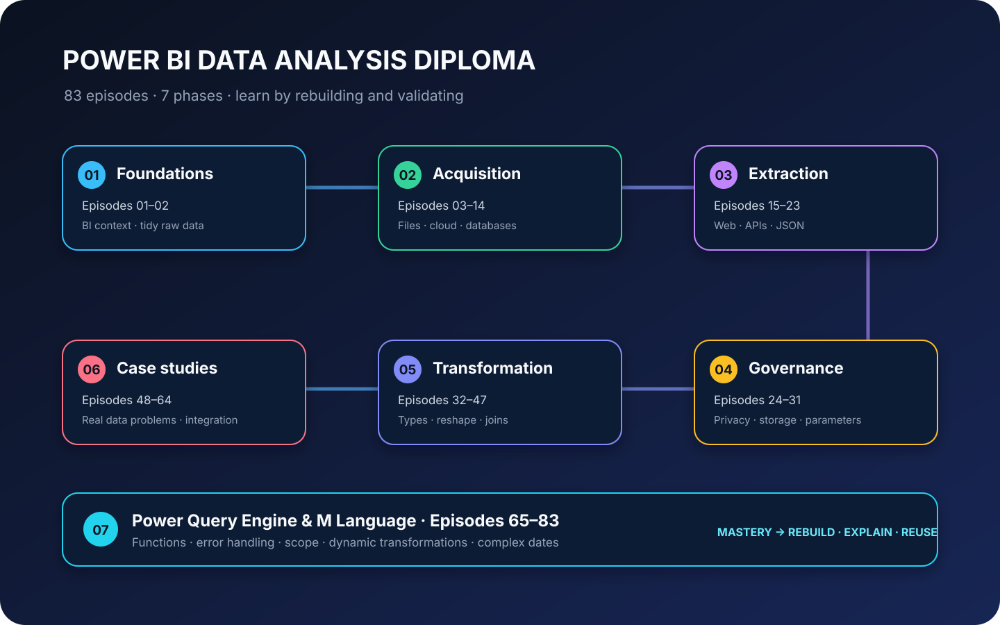
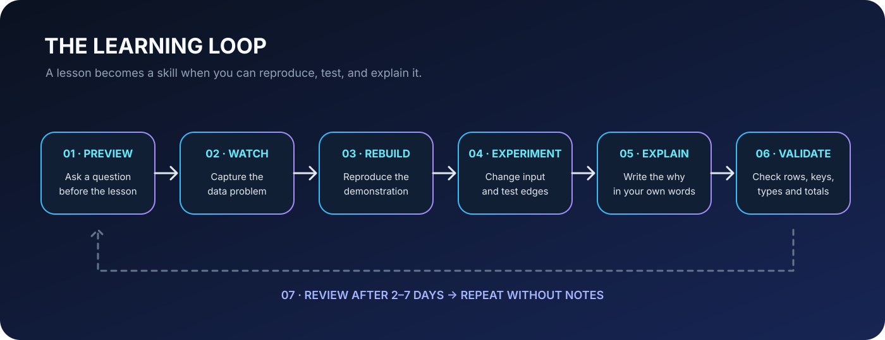

# Learning Roadmap · Power BI Data Analysis Diploma

      

A competency-based roadmap for the 83-episode course. Follow the course order, but judge progress by what you can reproduce and explain—not by videos watched.

## Roadmap overview

| Phase | Episodes | Core capability | Exit evidence |
|---|---:|---|---|
| 01 · Foundations | 01–02 | Understand BI workflow and raw-data structure | Explain grain, records, fields, and why tidy source data matters |
| 02 · Acquisition | 03–14 | Connect to files, cloud services, and databases | Reconnect to a new source and explain connector, credential, and refresh choices |
| 03 · Advanced extraction | 15–23 | Extract web data, call APIs, paginate, and normalize JSON | Build a bounded extraction flow and validate completeness |
| 04 · Governance | 24–31 | Manage privacy, credentials, storage modes, dataflows, and parameters | Explain refresh/security boundaries and parameterize a reusable template |
| 05 · Transformation | 32–47 | Clean types, reshape, append, merge, and create columns | Transform unfamiliar source data while preserving grain and reconciling rows |
| 06 · Case studies | 48–64 | Solve messy, multi-source analytical problems | Deliver an explainable end-to-end Power Query solution |
| 07 · M & engine | 65–83 | Write M, use functions, handle errors, and build dynamic transformations | Write and test reusable M logic with explicit assumptions and edge cases |

## Recommended 8-week pacing

This is a suggested sequence, not a deadline. Increase or reduce weekly workload based on lecture duration and hands-on complexity.

| Week | Focus | Practical outcome |
|---|---|---|
| 1 | Episodes 01–14 | Source literacy and connector confidence |
| 2 | Episodes 15–23 | Web/API extraction and pagination |
| 3 | Episodes 24–31 | Governance and parameterized connections |
| 4 | Episodes 32–39 | Type safety and column transformations |
| 5 | Episodes 40–47 | Reshaping, appending, joins, fuzzy matching |
| 6 | Episodes 48–56 | Case-study problem solving and model thinking |
| 7 | Episodes 57–68 | Robust ingestion, locale, errors, and engine behavior |
| 8 | Episodes 69–83 | M fundamentals, functions, dynamic transformations, capstone review |

## Skill gates

- **Gate A — Source ready:** Can you identify the source object, schema, grain, and refresh constraints?
- **Gate B — Transform safely:** Can you explain each transformation and validate its effect on row count and types?
- **Gate C — Model correctly:** Can you verify key uniqueness, relationship cardinality, and total reconciliation?
- **Gate D — Engineer resiliently:** Can your query handle nulls, missing fields, schema drift, and invalid inputs?
- **Gate E — Teach it back:** Can you reproduce the solution from a blank query and explain trade-offs without notes?

## Weekly learning loop

1. **Preview:** write one question before watching.
2. **Watch:** capture the problem, not a transcript.
3. **Rebuild:** follow the lesson using the tracked practice asset.
4. **Experiment:** change a value, add a row, remove a field, or test an edge case.
5. **Explain:** write a short problem → decision → result explanation.
6. **Validate:** check types, grain, row counts, keys, totals, and refresh.
7. **Review:** revisit the skill after 2–7 days and rebuild without notes.

## Milestone projects

| Milestone | Suggested episodes | Deliverable |
|---|---|---|
| Source integration | 03–14 | A documented query connecting a file and a second source |
| Extraction pipeline | 15–23 | A paginated or nested-data extraction with completeness checks |
| Transformation lab | 32–47 | A reusable cleaning/reshape/merge workflow |
| Case-study solution | 48–64 | A validated PBIX or query package with assumptions and reconciliation |
| M engineering lab | 69–83 | Typed custom function, error handling, and dynamic schema/date transformation |

## Track actual progress

- [Episode practice catalog](EPISODE_PRACTICE_CATALOG.md) — exact tracked assets per episode.
- [Learning log](LEARNING_LOG.md) — dated sessions, evidence, blockers, and next steps.
- [Progress tracker](../PROGRESS_TRACKER.md) — episode status and review dates.
- [Documentation standard](DOCUMENTATION_STANDARD.md) — keep lesson notes consistent.

**Completion rule:** mark an episode as mastered only after you can reproduce the key task, validate the result, and explain the reasoning. A watched video alone is not mastery.
